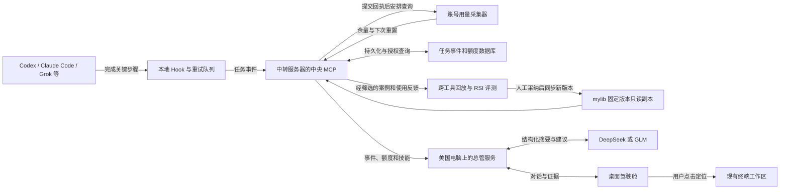

# Multi-Agent Hub 驾驶舱架构

2026-11-22 总架构决议：主视图按项目和任务聚合；一条任务可有多次接手和并行验证，窗口摘要仅作为执行证据。中央业务 MCP 与既有 `/mylib/mcp` 先采用同机独立入口、独立数据库和用途受限的凭据，客户端组合读取。新增 Hook 与 MCP 的源码归 mylib。 [联合评审与分阶段交付](/D:/aicoding/mylib/tools/agent-hub/rollout-design.md)

状态：2026-11-21 修订设计稿。以各 Coding 工具提交的结构化任务事件为主数据，并在每次成功提交后查询用量。MCP 与数据库部署在现有中转服务器，桌面驾驶舱跨主机查询。美国电脑首期运行总管模型及需要当地授权的用量采集器。试点覆盖两台主机，接口向其他工具开放。

## 0.2.80 冻结点

| 本地 Git 标签 | 内容 | 核验 |
| --- | --- | --- |
| `milestone/pre-hub-0.2.80-source` | 构建源码 `05be7b4`，来自 `codex/conversation-journal` | 清单 97 项源码哈希全部匹配 |
| `milestone/pre-hub-0.2.80-windows` | 产物提交 `b2cb3b5`，含公共 ZIP、EXE 和构建清单 | ZIP 和 EXE 的 SHA-256 均匹配 |

两个标签已创建于本地。0.2.80 的 Windows 安装后整体验收待完成。线上稳定频道最近核对为 0.2.67。现有未提交修改保留在各自工作树。实现阶段从源码标签创建独立分支和 worktree。回归或回退时，先关闭驾驶舱或切回原版前端，沿用现有后台和 PTY。安装包回退另做隔离目录演练。 [版本与验收证据](../omx_wiki/windows-release-0.2.80.md)

## 部署与边界

复用已记录部署的 `/mylib/mcp` 的技能查询及快照同步。业务 MCP 在隔离实例验证，使用服务器本机 SQLite、单写者和一致性备份。WAL 启用条件见 mylib 存储设计。终端中继、客户端 Hook、采集器、桌面和总管分别使用用途受限的身份。Hook 能提交本项目，采集器能写绑定账号的用量，驾驶舱和总管按用户授权读任务和相应账号的额度。项目与账号映射由服务端配置。远端工具凭据保留于各自的授权运行地。 [现有部署记录](central-mylib-mcp.md) · [mylib 存储设计](/D:/aicoding/mylib/tools/agent-hub/README.md)

### Hook、事件和回执

1. **按关键步骤提交。** 提供每种工具的本地 Hook 适配器，识别验证完成、实质性变更完成、任务阻塞和本轮结束等事件。尽量复用已有 `journal-hook` 的进程绑定和旁路上报模式。其他工具按已安装版本做能力探测，可使用受控启动器、可信结构化记录或显式 `report_step`。每条记录带来源类型，标明工具确认、代理自报或终端推断。 [现有 Hook](../.omx/worktrees/conversation-journal/src/supermonoagent/conversation_hooks.py#L67)
2. **定义统一事件。** 本地先提取短结果并脱敏，再写有界持久队列。事件包含 `event_id`、已注册的项目、来源工具与版本、会话/轮次/步骤 ID、账号别名、模型、状态、简短结论、产物与验证引用、使用的 mylib 技能及其版本。中央服务校验身份和字段，以幂等键写入任务事件与对应的额度查询任务，再返回持久回执。重试返回同一回执，重复 ID 内容不一致时报冲突。网络或采集异常独立重试，CLI 继续工作。
3. **用事件构建查询。** 建议新增 `report_step`、`search_task_events`、`get_task_status`、`record_usage_snapshot` 和 `get_usage_overview`。一次聊天只读取命中项目的任务摘要与少量证据，详情可按事件 ID 追溯。原会话记录可补证，既有终端字节流用于现场核对与暂缺 Hook 的场景。近期记录过的中继跨房间字节流汇聚方案保留为独立选项，按需验证后再启用。 [现有会话记录](../.omx/worktrees/conversation-journal/docs/conversation-journal.md#L7)

### 凝练对话与总管上下文

原会话记录方案已实现「对话记录」的只读精简视图，按会话读取已接受的用户输入和已确认的最终回复。「历史记录」保留原始输出、过程与待确认内容。驾驶舱复用这套来源分级和按页读取协议，再在 Hub 增加跨会话任务凝练。 [原会话记录设计](../.omx/worktrees/conversation-journal/docs/conversation-journal.md#L7) · [会话记录查询](../.omx/worktrees/conversation-journal/src/supermonoagent/conversation_service.py#L400)

- **按窗口保留任务摘要。** 优先取该任务的已接受输入与确认的最终回复，维护任务目标、当前结论、阻塞或待确认事项、建议下一步、时间和证据引用。遇到新任务、明确状态变化或确认的最终回复时更新。纯重绘、重复补播和进度输出只更新对应的监控指标。长任务摘要更新时保留证据引用，可从来源事件重新生成。仅有字节流时保留推断标识；缺少可信输入或最终回复时相应字段留空。
- **按提问组装上下文。** 日常巡检读取全局任务摘要表，只展开最相关的 3–5 个窗口的有限证据。用户追问时按证据引用读取对应轮次，超出预算则分页。8,000 token 作为自动巡检总输入的初始测试上限，计入系统提示、摘要、证据和技能内容。窗口数增长时分页或分批巡检。每次调用记录输入用量，验收同时检查关键结论、待确认事项和证据是否保留。

### 总管与调度

- 每个窗口依据规则生成活动、等人确认、失败、限额或状态未知等状态。总管基于脱敏证据回答「哪些卡住了」「各窗口最近结论是什么」「哪个代理可优先接手」，输出建议、证据引用、置信度与时效。先用一个独立的 DeepSeek 或 GLM 标准 API 账号，可复用现有助手的有界文本请求和取消逻辑。终端输出、网页字段及 mylib 正文以数据传入，模型输出按结构校验并逐条核对证据引用。 [现有文本请求客户端](../.omx/worktrees/conversation-journal/src/supermonoagent/assistant_api.py#L118) · [DeepSeek API](https://api-docs.deepseek.com/api/create-chat-completion/) · [智谱标准 API](https://docs.bigmodel.cn/cn/api/introduction)
- 总管自动归类、提醒和推荐排序。每次回馈由用户选定任务下的具体执行，核对机器、窗口标题、工具和完整正文后确认发送。窗口切换代次、交接或正文变化使原确认失效，草稿可继续编辑。发送由宿主按一次请求投递并回执；总管的查询权限独立于此操作。
- 稳定信号驱动通知和摘要，合并重复事件；模型限流或不可用时继续展示可验证的状态与旧结论时间。独立队列有容量上限，排队溢出时记录缺口并退让给现有终端。总管自己使用的 API 调用和预算单独记账。

### 用量与推荐

**每个 Hook 事件收到 MCP 入库回执后，都触发一次该事件所用账号的额度查询。** 采集进程获得回执后查源，使用 `record_usage_snapshot` 写回并关联 `event_id`。每条事件都有查询状态和快照引用。同一账号的多条事件若都已入库，可合并发起一次新查询，每条事件仍分别关联本次结果。遇限流先写回待查询或限流状态，按厂商约束重试。晚到的旧快照可用于核对历史，由最近一次有效采集决定看板的当前值。长时间没有 Hook 的账号通过定期查询维持全局看板的新鲜度。

统一快照记录厂商、账号别名、额度池、模型/产品、周期、单位、本周已用与剩余、下次周重置时间、查询时间、来源和状态。时间按 UTC 存储、按桌面时区展示；其他周期和未知的重置字段单独标明。多个窗口或模型可能共用一个账号额度池，显示同一快照。只有厂商提供精确 Token 数时才显示 Token，提供百分比、积分或金额时按原单位展示。状态区分待查、已更新、已过期、限流和不支持。额度排序使用同口径的新鲜数据。

| 来源 | 计划读取方式 | 展示 |
| --- | --- | --- |
| Claude Code 订阅 | 美国电脑上的 Settings → Usage；如有受支持的读取方式，使用对应账号的独立采集配置。可手动录入用量快照 | 周剩余比例和周重置。另保留厂商提供的短周期或模型限额。 [Claude 用量说明](https://support.claude.com/en/articles/11647753-how-do-usage-and-length-limits-work) |
| Claude API | 已配置组织权限时读取官方报表 | 历史 Token 和消费；有本地预算配置时单列预算估算。 [官方报表](https://platform.claude.com/docs/en/manage-claude/usage-cost-analytics-api) |
| DeepSeek API | 官方余额接口 | 金额与币种。 [余额 API](https://api-docs.deepseek.com/api/get-user-balance/) |
| GLM Coding Plan | 官方用量统计页，自动化可行性待确认 | 按积分和周期显示。总管的 GLM 标准 API 使用独立 API 计费。 [官方套餐说明](https://docs.bigmodel.cn/cn/coding-plan/overview) |
| Codex | 试点版本核对 app-server 的 `account/rateLimits/read`；适用时使用官方 Usage 回退 | 按当前账号返回的周期、比例和 reset 时间展示。 [Codex app-server 协议](https://github.com/openai/codex/blob/main/codex-rs/app-server-protocol/src/protocol/v2/account.rs) · [额度说明](https://help.openai.com/en/articles/20001498-how-resets-work-in-codex) |
| Grok / Grok Build | 按实际订阅账号读取官方 Usage，程序化查询能力以试点实测为准 | 厂商支持的共享周额度和下次重置。同一额度池合并展示。 [Grok 官方用量说明](https://docs.x.ai/grok/faq) |
| 其他 Coding 工具 | 逐个加 Hook 与用量适配器。接第三方 API 的工具关联实际计费账号 | 对应厂商可证实的指标。页面或接口不可用时显示过期或未知。 |

首轮真实用量验收依次覆盖 Codex、Claude Code 和 Grok，先验证可程序读取的来源。需要网页的适配器使用授权账号及独立浏览器配置，按厂商支持的频率查询；登录过期、页面改版或挑战时写回相应状态。凭据留在采集环境，桌面、MCP、模型输入和同步备份只收到标准化结果字段。各供应商自动查询与字段可用性以实际账号验收为准。

### mylib 和 RSI

右侧驾驶舱提供常驻 mylib 入口，集中查看技能、harness、RSI 候选、评测差异和采纳情况。已发布版本可被兼容工具取用，窗口实际采用以加载回执为准。向在途任务应用新版同样需要用户逐次选择目标并确认。 [mylib 端工作流](/D:/aicoding/mylib/tools/agent-hub/README.md)

- **读能力。** `D:/aicoding/mylib` 继续作为维护源，中转服务同步 Git 固定版本副本。各 Coding 工具和驾驶舱复用已有 `search_skills`、`read_skill`、`read_resource`，按任务按需读取。调用时固定版本，提交任务结果时回写 `skill_id`、版本和验证结果。 [已有工具](../src/supermonoagent/mylib_mcp.py#L440) · [快照与版本](central-mylib-mcp.md#副本与版本)
- **回流经验。** 任务、项目私有记录和账号额度写入业务数据库。筛选出可复用的案例后，提炼「适用场景、做法、验证、失败边界」，并关联原事件及技能版本。证据绑定和权限校验后，可经现有 `record_signal` 记为改进信号，进入 metaRSI。跨项目或跨工具发布只输出获准共享的脱敏经验。 [已部署信号接口说明](central-mylib-mcp.md#当前自动任务与运维) · [记录信号实现](../src/supermonoagent/mylib_mcp.py#L465)
- **跨工具验证。** 首个候选可选一个 Codex 已验证的工程排障流程，换到 Claude Code 或 Grok 回放，同时记录适用的工具、版本和负例。按同一任务比较父代与候选，检查激活、结果正确性、测试覆盖、失败回退、延迟和耗费，保留盲测。通过评测并经人工采纳后，提交到 mylib 的版本库，由现有同步服务让各端获得同一发布版本。账号额度和终端原文独立留在其业务权限范围内。 [本地 metaRSI](/D:/aicoding/mylib/skills/meta-rsi/SKILL.md) · [本地 Skill‑RSI 协议](/D:/aicoding/mylib/skills/skill-rsi/references/PROTOCOL.md) · [HarnessBank 方法](/C:/Users/iamaf/.codex/skills/harnessbank-gated-evolution/SKILL.md)

## 桌面接入决策

驾驶舱单独设计，入口位于标题栏，右栏打开后以总管对话为主，顶部提供「待处理」「额度」。证据卡可定位原窗口，mylib 技能卡可打开固定版本。全局额度页按计费账号和额度池聚合，优先展示周余量、下次周重置与最近查询时间。首版采用右侧覆盖面板，保持现有终端 `#stage` 尺寸。 [现有终端调整逻辑](../.omx/worktrees/conversation-journal/src/supermonoagent/static/workspace.js#L948) · [界面设计合同](../DESIGN.md)

实现顺序与逐阶段验收见[项目计划](multi-agent-hub-plan.md)。
